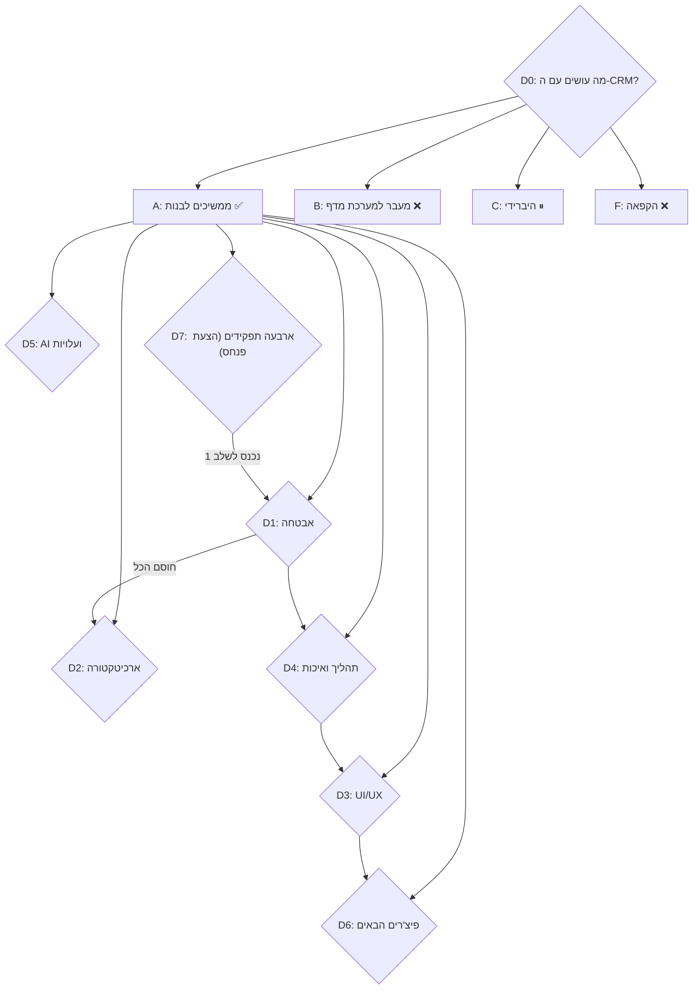

# תכנון סופי — Sales CRM
## דיון סוער, עץ החלטות וסימולציות

> נכתב ב-21.10.2026 על בסיס קריאה של הקוד בפועל (ענף `main`, commit `1887d78`).
> כל טענה טכנית בדיון מבוססת על ממצא אמיתי בקוד. איפה שמשהו לא נבדק עד הסוף, כתוב "לא אומת".
> ההחלטות של פנחס בסוף הן **סימולציה** לפי מה שאני יודע על סדרי העדיפויות שלו. הן לא החלטות שהוא קיבל בפועל.

---

## חלק א׳ — המשתתפים

| פרסונה | תפקיד | מה מניע אותו/ה | הטיה מובנית |
|---|---|---|---|
| **אבי** | CTO / ארכיטקט | "שזה יעבוד ויחזיק" | אוהב לבנות מחדש |
| **נועה** | חוקרת אבטחה | "כל חור ייפרץ בסוף" | רואה סכנה בכל מקום |
| **דנה** | מעצבת UX | "נציג צריך להבין את המסך בשנייה" | רוצה ליטוש |
| **יוסי** | נציג מכירות בשטח (משתמש אמיתי) | "אני בטלפון, בין שיחות, אין לי זמן" | שונא שינויים |
| **רחל** | כספים | "כל שקל חודשי זה שקל שלא נכנס" | אומרת "לא" כברירת מחדל |
| **מיכל** | QA, שומרת הסף | "פנחס לא קורא קוד, אז אני חייבת לתפוס הכל" | רוצה בדיקות לכל דבר |
| **עמית** | פרקליט השטן | "למה בכלל לבנות CRM? יש Pipedrive" | נגד הכל |
| **המנכ"ל** | שותף מייסד (סוכן) | "מה מכניס כסף החודש?" | חותך פרפקציוניזם, יש לו עמדה |

---

## חלק ב׳ — הדיון

### סבב 0: האם בכלל להמשיך?

**עמית:** אני אגיד את מה שכולם חושבים. יש פה 21 אלף שורות קוד, שלוש מערכות שונות שמנסות להיות אחת: CRM, מערכת קורסים, ומחולל שיווק. Pipedrive עולה 15 דולר לנציג בחודש. תסגרו את זה ותעברו.

**המנכ"ל:** ופנחס יאבד את מה שבאמת מייחד אותו. המסרים השבועיים, תוכנית השיווק, הקורסים, הצ'אט. כולם במקום אחד ובעברית מלאה מימין לשמאל. Pipedrive לא יודע לעשות אף אחד מאלה.

**רחל:** רגע. כמה עולה לנו היום להחזיק את המערכת?

**אבי:** Vercel ו-Supabase בתוכניות החינמיות, פלוס Claude API לפי שימוש. כמעט אפס.

**רחל:** אז Pipedrive יקר יותר. עם 3 נציגים זה כ-160 ש"ח בחודש, לנצח. עמית, זה לא חוסך כלום.

**עמית:** זה חוסך את הסיכון. תסתכלו על הקוד. כל משתמש שנרשם יכול למחוק את כל קבצי הקורסים. אתם יושבים על פצצה.

**נועה:** ...הוא צודק בזה. אגיע לזה עוד דקה.

**המנכ"ל:** אז מתקנים את הפצצה. לא זורקים את הבית.

> 🔀 **צומת החלטה D0:** להמשיך לבנות / לעבור למערכת מדף / לשלב (מדף ל-CRM, שלנו לשיווק ולקורסים) / להקפיא

---

### סבב 1: אבטחה — נועה מפוצצת את החדר

**נועה:** אני מציגה את הממצאים לפי חומרה. אחר כך תצעקו.

**ממצא 1 — הרשמה עצמית פתוחה, וקישור אוטומטי לפי מייל.**
במסך הכניסה כל אחד יכול ללחוץ "בקשת גישה" וליצור משתמש ב-Supabase (`src/api.ts`, הפונקציה `apiRegister`). בשרת, אם המייל של המשתמש מופיע ברשימת המאושרים, הוא **מקושר אוטומטית** לחשבון ה-CRM (`api/_lib/auth.ts`).
אם ב-Supabase **אימות מייל כבוי**, מישהו שיודע את המייל של נציג שעוד לא נכנס למערכת יכול להירשם איתו ולקבל את כל הלידים שלו. **לא אימתתי אם אימות המייל דלוק.** זו בדיקה של דקה בלוח הבקרה של Supabase.

**ממצא 2 — קבצי הקורסים פתוחים לכל משתמש מחובר.**
ב-`supabase-courses-migration.sql` (שורות 55–77): כל משתמש `authenticated` יכול להעלות, לשנות ו**למחוק** כל קובץ בדלי `course-files`. בגלל ממצא 1, "מחובר" כולל גם מי שנרשם לבד ולא אושר מעולם. הוא לא צריך את ה-CRM בכלל. מספיק לו מפתח ה-anon שחשוף בדפדפן.

**ממצא 3 — קורסים ושיווק פתוחים לכתיבה ולמחיקה לכל נציג.**
ב-`api/state.ts:613` מוגדר `canWrite: () => true, canDelete: () => true` לקורסים, שיעורים, תוכן, מאגר ידע ומסרים. נציג מכירות אחד שמתעצבן, או סתם לוחץ לא נכון, מוחק את כל תוכנית השיווק של פנחס.

**ממצא 4 — כל נציג מקבל את כל ההגדרות.**
ה-GET מחזיר לכל אחד את `users` (מיילים, טלפונים, **אחוזי עמלה של כל הנציגים**), יעדי מכירות וכללי אוטומציה. בקוד יש גם שדה `password` בסוג `User`, עם ההערה "גלויה למנהל בלבד" (`src/types.ts:17`). הקוד החדש כבר לא שומר שם סיסמה, אבל **לא אימתתי** שאין סיסמאות ישנות בשורת ה-config במסד.

**ממצא 5 — הרשאות הלשוניות מבוטלות.**
`src/App.tsx:624`: `// TEMP BYPASS — כל הלשוניות פתוחות לכולם`. ממילא זו הסתרה בממשק בלבד, לא הגנה אמיתית.

**ממצא 6 — כל משתמש מחובר יכול לשרוף קרדיט של Claude.**
`api/marketing-generate.ts` בודק רק שהמשתמש מחובר. אין הגבלה על כמות הבקשות ואין בדיקת תפקיד.

**ממצא 7 — השרת מחזיר הודעות שגיאה פנימיות.**
`details: String(err)` (`api/state.ts:39`, `:631`) חושף ללקוח שמות טבלאות והודעות של מסד הנתונים.

**ממצאים קטנים:** סיסמה מינימלית של 6 תווים. מיילים נרשמים בלוגים של Vercel. קבצי הקורס ניתנים לקריאה ציבורית לכל מי שמחזיק קישור.

**אבי:** אוקיי, 1 ו-2 רציניים. אבל 4? אחוזי עמלה? נו באמת.

**נועה:** תשאל את יוסי מה הוא מרגיש כשהוא מגלה שהנציג השני מקבל 15% והוא מקבל 10%.

**יוסי:** ...אני לא הייתי מגלה, כי אני לא פותח את כלי המפתח בדפדפן. אבל הבן שלי כן.

**רחל:** זה גם עניין משפטי. טלפונים ומיילים של עובדים הם מידע אישי.

**אבי:** בסדר. אבל אני לא מוכן שנעשה עכשיו ארכיטקטורת הרשאות מלאה עם RLS לכל טבלה. זה שבועיים עבודה.

**נועה:** אף אחד לא ביקש RLS מלא. כל הגישה עוברת דרך השרת שלנו עם service role. מה שצריך:
1. לסגור הרשמה עצמית.
2. להגביל את מדיניות האחסון למשתמשים מאושרים, או רק למנהל.
3. קורסים ושיווק: נציג יכול לקרוא, רק מנהל יכול לכתוב.
4. לסנן את `users` לפני שליחה לנציג.
זה יום עבודה, לא שבועיים.

**מיכל:** ואני רוצה בדיקה אוטומטית לכל אחד מהם. "נציג מנסה למחוק קורס ← מקבל סירוב". בלי זה, ה-TEMP BYPASS הבא יחזור.

**המנכ"ל:** 1 עד 4 עכשיו, השבוע. לפני כל פיצ'ר. זה לא נתון לוויכוח. 5 עד 7 בסבב הבא.

**עמית:** ואם ממילא סוגרים הרשמה, למה לא לעבור ל-Google Login בלבד? אין סיסמאות, אין ממצא סיסמה חלשה.

**דנה:** כי לחצי מהנציגים של פנחס אין חשבון Google מסודר, או שיש להם שלושה ולא זוכרים איזה.

**יוסי:** נכון. אני נכנס עם מייל וסיסמה. אל תיגעו לי בזה.

> 🔀 **צמתים:** D1.1 הרשמה · D1.2 אחסון קבצים · D1.3 הרשאות קורסים ושיווק · D1.4 מידע אישי בהגדרות · D1.5 לשוניות · D1.6 עלות AI · D1.7 דליפת שגיאות · D1.8 מדיניות סיסמאות

---

### סבב 2: ארכיטקטורה וקוד — אבי נגד המנכ"ל

**אבי:** הבעיה האמיתית היא לא אבטחה, היא הארכיטקטורה. כל 10 שניות כל דפדפן פתוח מושך את **כל** המצב: כל הלידים, כל הפעילויות, כל הקורסים, כל פריטי התוכן, כל המסרים (`src/App.tsx:319`). עם 5 נציגים ו-2,000 לידים זה מאות מגה ביום. בסוף נשבור את המכסה החינמית.

**רחל:** "בסוף" זה מתי?

**אבי:** תלוי בכמות. עם הנתונים של היום, כנראה לא בקרוב. אבל קבצי ה-base64 של התמונות מתוך תוכן הקורסים...

**המנכ"ל:** אז אנחנו מתכננים לבעיה שאין לנו. כמה לידים יש היום?

**אבי:** אין לי גישה למסד. לא יודע.

**המנכ"ל:** אז ההחלטה הראשונה היא למדוד. לא לבנות מחדש.

**אבי:** בסדר, אבל יש עוד דברים:
- **אין טרנזקציות.** שמירה עוברת על 10 טבלאות ברצף. אם השלישית נכשלת, הראשונות כבר נשמרו והשאר לא. חצי שמירה.
- **403 על לידים אחרי שכבר נשמרו חלק** (`api/state.ts:550`). הנציג רואה שגיאה, אבל חלק מהשינויים שלו כבר נכנסו.
- **קבצי ענק:** `LeadsView.tsx` עם 1,367 שורות, `SettingsPanel.tsx` עם 971, `App.tsx` עם 821. כל שינוי שם מסוכן.
- **אין אף בדיקה אוטומטית.** אפס.
- **שני פרויקטים ב-Vercel** מתפרסים מאותו ענף, ותיקיית `dist` וסקריפט `build:plugin` של וורדפרס עדיין בקוד.
- **מיגרציות SQL זרוקות בתיקייה הראשית**, בלי סדר ובלי מעקב אחרי מה רץ.
- **המודל במחולל השיווק מקובע** ל-`claude-sonnet-4-6` (`api/marketing-generate.ts:75`). זה מודל ישן.

**מיכל:** הבדיקות הן הדבר הכי חשוב ברשימה. פנחס לא קורא קוד. אם אין בדיקות, אף אחד לא יודע מה נשבר.

**המנכ"ל:** מסכים לבדיקות, אבל בדיקות **על מה שכואב**: הרשאות ושמירה. לא בדיקות "כיסוי 80%" לכפתורים.

**אבי:** ופיצול הקבצים הגדולים?

**המנכ"ל:** רק כשנוגעים בהם בגלל פיצ'ר. לא פרויקט בפני עצמו.

**אבי:** זה ייגמר בזה שאף פעם לא נפצל.

**המנכ"ל:** אז אף פעם לא נפצל, וזה בסדר, כל עוד זה עובד.

**אבי:** (בכעס) אתה מבין שבגלל גישה כזו כמעט איבדנו לידים בשבוע שעבר? שמירת ה-state המלא מחקה רשומות של משתמשים אחרים.

**המנכ"ל:** ותיקנו את זה ביום אחד, כי זה כאב. זה בדיוק הכלל: מתקנים מה שכואב.

**עמית:** ומה עם Supabase Realtime במקום ריענון כל 10 שניות?

**אבי:** זה הפתרון הנכון. אבל הוא דורש RLS על הטבלאות, כי Realtime עובד עם מפתח ה-anon. כלומר, כן, בדיוק השבועיים שלא רציתי.

**נועה:** ואם תפתחו Realtime בלי RLS מושלם, כל נציג יקבל בשידור חי את כל הלידים של כולם. אני מעדיפה ריענון כל 10 שניות.

> 🔀 **צמתים:** D2.1 סנכרון · D2.2 טרנזקציות · D2.3 בדיקות · D2.4 פיצול קבצים · D2.5 ניקוי (dist, Vercel כפול, וורדפרס) · D2.6 מיגרציות · D2.7 מודל AI

---

### סבב 3: UI/UX — דנה ויוסי נגד כולם

**דנה:** אני שואלת שאלה פשוטה: מי המשתמש העיקרי?

**יוסי:** אני. נציג. בטלפון. בין שיחה לשיחה.

**דנה:** אז תסתכלו על הקוד. בכל הממשק יש בסך הכל **20** התאמות למסכים קטנים ו-**11** תוויות נגישות. המערכת נבנתה למחשב שולחני. נציג בטלפון סובל.

**יוסי:** אני בעיקר רוצה שלושה דברים: לראות מה אני צריך לעשות היום, לעדכן סטטוס של ליד בלחיצה אחת, ולהתקשר או לשלוח וואטסאפ ישר מהליד.

**דנה:** ובמקום זה יש לו: לשוניות של קורסים, שיווק, עורך עיצוב, צ'אט, נתונים, מוצרים. בגלל ה-TEMP BYPASS הוא רואה את כולן.

**המנכ"ל:** זו בדיוק הנקודה. הלשוניות האלה הן של פנחס, לא של הנציג.

**אבי:** אז מחזירים את סינון הלשוניות.

**דנה:** לא רק מחזירים. מגדירים מחדש: לנציג יש **מסך בית אחד**, "היום שלי": משימות להיום, לידים חמים, פולואפים שעבר זמנם. כל השאר מוסתר.

**רחל:** כמה זמן זה?

**דנה:** גרסה פשוטה: 2–3 ימים. גרסת "וואו" עם אנימציות ומד התקדמות משחקי: שבוע וחצי.

**המנכ"ל:** פשוטה. הנציגים צריכים לסגור עסקאות, לא להתפעל.

**דנה:** (מתעצבנת) בכל סבב אתה חותך את העיצוב. ה-Luxury theme שנכנס לפני שבועיים, שמישהו בכלל ביקש, לא עזר לאף נציג לסגור עסקה. ועכשיו כשאני מבקשת דבר שבאמת עוזר לנציגים, זה "מותרות"?

**המנכ"ל:** ...נקודה הוגנת. ה-Luxury theme היה טעות של סדרי עדיפויות. אבל "היום שלי" בגרסה הפשוטה, ובגרסה הבאה מוסיפים לפי משוב של יוסי.

**יוסי:** ועוד דבר: כשיש עדכון, אני מקבל "גרסה חדשה של המערכת זמינה — רעננו את הדף". ואם הייתי באמצע לכתוב הערה על ליד, היא נעלמת.

**אבי:** זה ה-409 מהתיקון של איבוד הנתונים. בלעדיו לקוחות ישנים היו מוחקים נתונים.

**דנה:** אז שהמערכת תשמור את הטיוטה בדפדפן, תרענן לבד, ותחזיר את הטיוטה. ככה הנציג לא מאבד כלום.

**מיכל:** ומחיקות? יש 3 מקומות עם `confirm()` של הדפדפן, חלון אפור ומכוער. ובשאר המקומות מוחקים בלי שום אישור?

**דנה:** בדיוק. אני רוצה "בטל" במקום "האם אתה בטוח": הודעה קטנה "הליד נמחק — בטל" ל-10 שניות.

**אבי:** זה דורש מחיקה רכה במסד, כלומר עמודה `deleted_at`, כלומר מיגרציה שפנחס צריך להריץ ידנית.

**המנכ"ל:** אז בינתיים חלון אישור מסודר בעיצוב שלנו, בלי מיגרציה. מחיקה רכה כשיש סיבה נוספת לגעת במסד.

> 🔀 **צמתים:** D3.1 מובייל · D3.2 מסך הבית לנציג · D3.3 לשוניות לפי תפקיד · D3.4 רענון שמאבד טיוטות · D3.5 מחיקות · D3.6 נגישות · D3.7 עיצוב Luxury ועורך העיצוב

---

### סבב 4: תהליך — מי מאשר מה

**מיכל:** פנחס לא קורא קוד. כרגע כל מיזוג ל-main עולה ישר לאוויר. אין שום שער.

**המנכ"ל:** מה את מציעה?

**מיכל:** כל PR עובר אצלי: בנייה עוברת, בדיקות הרשאות עוברות, וסרטון או צילומי מסך של הפיצ'ר עוברים לפנחס. פנחס מאשר לפי ההדגמה, לא לפי הקוד.

**רחל:** ומה עולה GitHub Actions?

**אבי:** בריפו פרטי יש 2,000 דקות חינם בחודש. בקצב שלנו זה מספיק בשפע.

**עמית:** ומי בודק את מיכל?

**מיכל:** הבדיקות האוטומטיות. בגלל זה הן חשובות.

**אבי:** ואני רוצה סביבת staging. Vercel נותן Preview לכל PR בחינם, אבל הוא מחובר לאותו מסד Supabase של הייצור.

**נועה:** כלומר כל בדיקה ב-Preview כותבת לנתונים האמיתיים. זה מסוכן.

**רחל:** פרויקט Supabase שני חינמי? מותר שניים בחינם.

**אבי:** מותר. אבל אז פנחס צריך להריץ כל מיגרציה פעמיים.

**המנכ"ל:** אז לא עכשיו. Preview משמש להסתכל, לא לבדוק כתיבה. בדיקות הכתיבה רצות בבדיקות אוטומטיות מול מסד מדומה.

> 🔀 **צמתים:** D4.1 שער QA · D4.2 CI · D4.3 staging · D4.4 אישור לפי הדגמה

---

### סבב 5: AI ושיווק — רחל נגד המנכ"ל

**רחל:** מחולל השיווק הוא היחיד שעולה כסף אמיתי. כל לחיצה מחזירה עד 4,096 טוקנים.

**המנכ"ל:** וזה גם הדבר שהכי חוסך לפנחס זמן. 5 מסרים שבועיים מחומר גולמי אחד.

**רחל:** אני לא אומרת לבטל. אני אומרת להגביל: רק מנהל, ומקסימום X הפעלות ביום.

**אבי:** ולעבור למודל עדכני. ואולי מודל קטן וזול לטיוטה ראשונה?

**המנכ"ל:** לא. האיכות של הכתיבה היא כל הסיפור פה. מודל חזק, אבל רק למנהל.

**עמית:** ומה עם כל רעיונות ה-AI הנוספים: ניקוד לידים חכם, סיכום שיחות, הצעות פולואפ?

**המנכ"ל:** אחרי שיש רצפה יציבה של הכנסות. לא עכשיו.

> 🔀 **צמתים:** D5.1 מי מפעיל · D5.2 מודל · D5.3 מכסה · D5.4 פיצ'רי AI חדשים

---

### סבב 6: מה בונים אחרי שהכל יציב?

**יוסי:** וואטסאפ ישר מהליד, בלחיצה. תבנית הודעה מוכנה.

**המנכ"ל:** זה הפיצ'ר עם הכי הרבה כסף מאחוריו. נציג שמגיב לליד תוך 5 דקות סוגר הרבה יותר.

**אבי:** קישור `wa.me` עם טקסט מוכן הוא חצי יום עבודה. חיבור ל-WhatsApp Business API הוא חודש, ועולה כסף על כל שיחה.

**רחל:** `wa.me`.

**המנכ"ל:** `wa.me`.

**דנה:** `wa.me`, אבל עם בחירת תבנית יפה.

**עמית:** סוף סוף כולם מסכימים על משהו. מפחיד.

**אבי:** ולידים נכנסים מהאתר? היום מכניסים ידנית או מייבאים מקובץ.

**המנכ"ל:** Webhook מטפסי האתר (וורדפרס) ישר ל-CRM. זה הדבר השני. ליד שנכנס לבד ומשויך לנציג לבד, זה כסף.

**נועה:** Webhook ציבורי חייב מפתח סודי, אחרת כל אחד שולח לכם אלף לידים מזויפים.

> 🔀 **צמתים:** D6.1 וואטסאפ · D6.2 לידים אוטומטיים מהאתר · D6.3 דוח יומי · D6.4 הפרדת מוצרים (קורסים ושיווק כאפליקציה נפרדת)

---

### סבב 7: ההצעה של פנחס — ארבעה תפקידים (נוסף ב-21.10.2026)

> פנחס הביא לשולחן הצעה משלו:
> 1. **מנהל:** גישה להכל, כולל שינוי.
> 2. **ניהול משרד:** גישה להכל, אבל בתכני הקורסים צפייה בלבד, בלי עריכה ובלי מחיקה.
> 3. **נציג מכירות:** רק מה שרלוונטי למכירות.
> 4. **מזכירות:** מה שרלוונטי למכירות, וגם מוצרים ושלבי קבלת לקוח.
>
> והעיקרון: **לשונית שלא רלוונטית לתפקיד לא קיימת בשבילו.** אין הרשאת גישה, אין תצוגה, והנציג אפילו לא יודע שיש לשונית קורסים.

**המנכ"ל:** זה בדיוק מה שחסר. עד עכשיו דיברנו על "מנהל או נציג", אבל במשרד של פנחס יש עוד אנשים. אני תומך בהצעה כמו שהיא.

**נועה:** אני תומכת בעיקרון, ואני רוצה לחדד מה המשמעות של "לא יודע שיש". הסתרה של כפתור זה לא מספיק. היום השרת שולח לכל משתמש את `navConfig`, הרשימה של **כל** הלשוניות כולל "קורסים", עם השמות שלהן. מי שפותח את כלי המפתח רואה אותה. "לא יודע שיש" אומר שלושה דברים:
1. השרת לא שולח את הנתונים.
2. השרת לא שולח את שם הלשונית ואת ההגדרות שלה.
3. השרת דוחה כל ניסיון לכתוב לשם, גם אם מישהו בונה בקשה בעצמו.

**אבי:** ויש רביעי: הקוד של מסך הקורסים עצמו יושב בקובץ ה-JavaScript שכל דפדפן מוריד. נציג סקרן שמחפש בתוכו ימצא את המילה "קורסים".

**נועה:** נכון, אבל שם אין נתונים, רק קוד של מסך ריק. זה לא דליפה.

**המנכ"ל:** אז 1 עד 3 עכשיו. פיצול הקוד (4) רק אם יהיה בזה צורך.

**רחל:** יש לי שאלה על "ניהול משרד — גישה להכל". הכל כולל **ניהול משתמשים**? כלומר, ניהול משרד יכול ליצור משתמשים, לשנות סיסמאות, ולשנות תפקידים?

**נועה:** אם כן, ניהול משרד יכול להפוך את עצמו למנהל בלחיצה אחת, ואז "צפייה בלבד בקורסים" לא שווה כלום. ביטחון של מערכת תלוי בדלת הכי חלשה שלה.

**המנכ"ל:** אז ניהול משתמשים, סיסמאות ותפקידים נשארים אצל פנחס בלבד. ניהול משרד מקבל את כל שאר ההגדרות: סטטוסים, מוצרים, שדות, תוויות.

**אבי:** ועורך העיצוב? וכללי האוטומציה?

**המנכ"ל:** אוטומציה כן, היא חלק מתפעול המשרד. עורך העיצוב נשאר למנהל, כי הוא משנה את המראה של כולם.

**רחל:** ומחולל השיווק? הוא עולה כסף.

**המנכ"ל:** "גישה להכל" זה "גישה להכל". ניהול משרד יכול להפעיל אותו, באותה מכסה יומית של 30. אם הוא ינוצל, נראה את זה במונה.

**רחל:** ועמלות? ניהול משרד רואה את העמלות של כל הנציגים?

**המנכ"ל:** כן. מי שמכין משכורות צריך לראות אותן. זה חלק מ"הכל".

**דנה:** עכשיו המזכירות. "רלוונטי למכירות + מוצרים + שלבי קבלת לקוח". שאלה ראשונה: המזכירה רואה רק את הלידים שלה, או את **כל** הלידים?

**יוסי:** אם המזכירה קובעת לי פגישות, היא צריכה לראות את הלידים שלי. אחרת איך היא תדע עם מי לקבוע?

**נועה:** אז היא רואה את כל הלידים. אבל האם היא יכולה **למחוק** אותם? או להעביר ליד מנציג לנציג?

**המנכ"ל:** לראות ולעדכן כן: סטטוס, הערה, פעילות, משימה. למחוק לא, כמו הנציג. להעביר ליד בין נציגים? כן. זה בדיוק תפקיד של מזכירות, לחלק לידים.

**יוסי:** רגע, אז המזכירה יכולה לקחת ממני ליד חם ולתת לנציג אחר?

**המנכ"ל:** כן, ופנחס יראה את זה ביומן הפעילות של הליד. זה תפקיד, לא איום.

**יוסי:** (לא מרוצה) בסדר. אבל אני רוצה לקבל הודעה כשלוקחים ממני ליד.

**דנה:** הוגן. ⏸ זה נכנס לרשימה של שלב 3.

**רחל:** והמזכירה רואה עמלות?

**המנכ"ל:** לא. עמלות זה לא מכירות, זה כסף. רק מנהל וניהול משרד.

**דנה:** שאלה שנייה, והיא הכי חשובה: **שלבי קבלת לקוח**. היום כשנציג סוגר עסקה, המערכת זורקת אותו ללשונית "קליטה". לפי ההצעה של פנחס, לנציג אין לשונית קליטה. אז מה קורה ברגע הסגירה?

**אבי:** הנציג ממלא את החלון הקטן (מוצר, סכום, אחראי), הלקוח נוצר, והנציג **נשאר** בלידים. מופיעה לו הודעה: "הלקוח הועבר לקליטה ✓".

**יוסי:** זה אפילו יותר טוב. אני לא רוצה לעשות קליטה. אני רוצה לחזור לטלפון.

**המנכ"ל:** וזה גם מה שמפריד בין התפקידים: הנציג סוגר, המזכירות קולטת. בדיוק כמו במשרד אמיתי.

**מיכל:** ואיך המזכירה יודעת שנכנס לקוח חדש לקליטה?

**דנה:** הוא מופיע בראש לשונית הקליטה, מסומן "חדש". והתראה אמיתית ⏸ בשלב 3.

**עמית:** אני חייב להגיד משהו. אתם בונים ארבעה תפקידים למשרד שיש בו, כמה, שלושה אנשים? זה over-engineering.

**המנכ"ל:** לא. עשינו את החשבון: הקוד כבר כותב עכשיו "מי רואה מה". ההבדל בין שני תפקידים לארבעה הוא טבלה אחת של הרשאות, ויום עבודה נוסף. לעומת זה, להוסיף תפקידים **אחרי** שהכל בנוי על "מנהל או נציג" זה לפתוח מחדש כל מסך.

**אבי:** ויש מחיר אחד שפנחס צריך לדעת: במסד יש היום חוק שמתיר רק `admin` או `salesperson`. כדי להוסיף תפקידים צריך מיגרציה. אבל ממילא יש מיגרציה בשלב 1 (קבצים והגנת טבלאות), אז זה נכנס לאותו קובץ ולאותה הרצה.

**נועה:** ודבר אחרון: **מי שהתפקיד שלו לא מוכר למערכת, לא רואה כלום.** אם מחר מישהו יכתוב במסד `role = 'intern'`, הוא לא מקבל "נציג" כברירת מחדל. הוא מקבל אפס.

**המנכ"ל:** מסכים. ברירת מחדל סגורה.

**דנה:** ומה עם ההגדרה "לשוניות מותרות" לכל משתמש, שקיימת היום במסך ההגדרות?

**המנכ"ל:** היא נשארת, אבל רק **לצמצם** בתוך התפקיד. פנחס יכול להוריד לנציג מסוים את הצ'אט, אבל לא יכול לתת לנציג קורסים. התפקיד הוא התקרה.

**עמית:** טוב. אני מוותר. בפעם הראשונה בדיון הזה, ההצעה הכי טובה הגיעה מבחוץ.

> 🔀 **צמתים:** D7.1 מודל התפקידים · D7.2 "לא יודע שיש" · D7.3 ניהול משרד · D7.4 מזכירות · D7.5 נציג מכירות · D7.6 מעבר מסגירה לקליטה · D7.7 תפקיד לא מוכר · D7.8 לשוניות אישיות · D7.9 שינוי במסד

---

## חלק ג׳ — עץ ההחלטות

**מקרא:** ✅ נבחר · ⏸ נדחה לשלב מאוחר יותר · ❌ נפסל · 💰 עלות חודשית · ⏱ זמן עבודה מוערך (של סוכן הפיתוח)

### מבט על (רמה עליונה)

### העץ המלא

- **D0 — מה עושים עם ה-CRM?**
  - **D0.A — ממשיכים לבנות את המערכת שלנו ✅**
    - **D1 — אבטחה** (שלב 1, חוסם כל פיצ'ר)
      - **D1.1 — הרשמה עצמית + קישור אוטומטי לפי מייל**
        - D1.1.a — סוגרים הרשמה. רק מנהל יוצר משתמשים ✅ ⏱ 2 שעות
          - D1.1.a.i — מוחקים את מסך "בקשת גישה" ✅
          - D1.1.a.ii — במקומו: "פנה למנהל" עם קישור וואטסאפ לפנחס ✅
          - D1.1.a.iii — טופס בקשה ששומר בקשות בתור לאישור ⏸ (אין מספיק בקשות שמצדיקות)
        - D1.1.b — משאירים הרשמה, ומחייבים אימות מייל ❌ (עדיין יוצר משתמשים "מחוברים" שלא אושרו, וזה בדיוק מה שפותח את ממצא 2)
        - D1.1.c — Google בלבד ❌ (לחלק מהנציגים אין חשבון מסודר)
        - D1.1.d — בדיקה ב-Supabase: האם אימות מייל דלוק ✅ (פנחס, דקה אחת, גם אם סוגרים הרשמה)
          - אם כבוי ← בודקים ב-Supabase Auth אם יש משתמשים שנרשמו ולא אושרו, ומוחקים
        - D1.1.e — הקישור האוטומטי לפי מייל
          - נשאר, אבל רק אם המייל של המשתמש מאומת (`email_confirmed_at`) ✅ ⏱ 30 דק׳
          - מבוטל לגמרי ❌ (שובר כניסה ראשונה של נציג שהמנהל אישר)
      - **D1.2 — אחסון קבצי קורסים**
        - D1.2.a — כתיבה ומחיקה: רק דרך השרת (service role). מוחקים את מדיניות `authenticated` ✅ ⏱ 3 שעות + מיגרציה אחת שפנחס מריץ
          - D1.2.a.i — העלאה דרך כתובת העלאה חתומה (signed upload URL) מהשרת ✅
          - D1.2.a.ii — מעבירים את כל ההעלאה דרך פונקציית Vercel ❌ (מגבלת 4.5MB תשבור מצגות)
        - D1.2.b — משאירים, אבל מגבילים לתיקייה אישית לכל משתמש ❌ (עדיין פתוח לנרשמים לא מאושרים)
        - D1.2.c — קריאה ציבורית
          - נשארת כרגע ✅ (התוכן הוא חומר לימוד, הקישורים ארוכים וקשים לניחוש)
          - קישורים חתומים עם תוקף ⏸ (רק אם יעלה תוכן בתשלום שצריך להגן עליו)
      - **D1.3 — הרשאות קורסים ושיווק** (⚠ עודכן בסבב 7 ← ראו D7)
        - D1.3.a — נציג קורא, רק מנהל כותב ומוחק ✅ ⏱ 1 שעה
        - D1.3.b — הרשאות לפי תפקיד חדש "עורך תוכן" ⏸ (אין כרגע עורך תוכן שאינו פנחס)
        - D1.3.c — נציג לא רואה קורסים ושיווק בכלל ✅ (משתלב עם D3.3)
          - בשרת: לא שולחים לנציג את הנתונים האלה ב-GET ✅ (גם חוסך תעבורה, ראו D2.1)
      - **D1.4 — מידע אישי בהגדרות**
        - D1.4.a — נציג מקבל רק: שמות המשתמשים (לצ'אט ולשיוך), הסטטוסים, הגדרות התצוגה ✅ ⏱ 2 שעות
          - D1.4.a.i — העמלה והיעד שלו בלבד ✅
          - D1.4.a.ii — לוח הישגים: כל נציג רואה את הסכומים של כולם ⏸ (החלטה עסקית: תחרות מול פרטיות. פנחס יחליט כשיהיו 3+ נציגים)
        - D1.4.b — לא אומת: האם יש סיסמאות ישנות בשורת `crm_config.users`
          - בודקים ומוחקים בסקריפט חד-פעמי ✅ ⏱ 30 דק׳
          - השרת מסנן `password` תמיד, בכל מקרה ✅
          - אם נמצאו סיסמאות ← מאפסים את הסיסמאות של כל המשתמשים ✅
      - **D1.5 — לשוניות לפי תפקיד**
        - D1.5.a — מחזירים את הסינון (מוחקים את TEMP BYPASS) ✅ ⏱ 1 שעה
          - קודם מבררים למה הוא נוסף ("עד שנתקן את התפקיד") ומתקנים את הסיבה ✅
        - D1.5.b — סינון בממשק בלבד ❌ כפתרון יחיד, ✅ כחלק מהפתרון (ההגנה האמיתית היא D1.3 ו-D1.4 בשרת)
      - **D1.6 — עלות AI**
        - D1.6.a — מחולל השיווק: מנהל בלבד ✅ ⏱ 15 דק׳
        - D1.6.b — מכסה: 30 הפעלות ביום ✅ ⏱ 1 שעה (נשמר בטבלה קיימת, בלי מיגרציה)
        - D1.6.c — התראה במייל כשעוברים סכום חודשי ✅ (מוגדר בקונסולת Anthropic, לא בקוד)
      - **D1.7 — דליפת שגיאות**
        - D1.7.a — ללקוח הולכת הודעה כללית בעברית, הפרטים נשארים בלוג ✅ ⏱ 30 דק׳
        - D1.7.b — מסירים מיילים מהלוגים ✅
      - **D1.8 — מדיניות סיסמאות**
        - D1.8.a — מינימום 8 תווים ✅ ⏱ 15 דק׳
        - D1.8.b — אימות דו-שלבי ⏸ (עד שיהיו יותר מ-5 משתמשים או נתונים רגישים יותר)
        - D1.8.c — הגבלת ניסיונות כניסה ✅ (קיים ב-Supabase כברירת מחדל, רק לוודא שדלוק)
    - **D2 — ארכיטקטורה וקוד** (שלב 2)
      - **D2.1 — סנכרון בין משתמשים**
        - D2.1.a — ממשיכים עם ריענון כל 10 שניות ✅
          - D2.1.a.i — מוסיפים מדידה: כמה שורות וכמה KB יש בכל טעינה ✅ ⏱ 1 שעה
          - D2.1.a.ii — ריענון רק כשהלשונית בדפדפן פעילה ✅ ⏱ 30 דק׳ (חוסך הרבה תעבורה מטאבים פתוחים ברקע)
          - D2.1.a.iii — ריענון "רזה": השרת מחזיר רק מה שהשתנה מאז הטעינה הקודמת ⏸ (נכנס אם המדידה תראה מעל 1MB בטעינה)
        - D2.1.b — Supabase Realtime ❌ כרגע (דורש RLS מלא, ובלעדיו חושף את כל הלידים של כולם)
          - ⏸ חוזרים לזה אם יהיו מעל 10 נציגים בו-זמנית
        - D2.1.c — בנייה מחדש עם צד שרת מלא (Next.js וכו׳) ❌ (שבועות עבודה בלי ערך לנציג)
      - **D2.2 — שמירה חלקית**
        - D2.2.a — פונקציית מסד (RPC) אחת שעושה את כל השמירה בטרנזקציה ⏸ (מיגרציה גדולה, שפנחס מריץ ידנית)
        - D2.2.b — סדר שמירה בטוח + ניסיון חוזר בצד הלקוח ✅ ⏱ 3 שעות
          - אם השמירה נכשלה, השינויים נשארים "ממתינים" ונשלחים שוב ✅
          - אינדיקטור "נשמר ✓ / שומר... / לא נשמר ⚠️" בפינת המסך ✅
        - D2.2.c — 403 על לידים: מחזירים 200 עם רשימת מה שנדחה, והממשק מציג "חלק מהשינויים לא נשמרו כי..." ✅ ⏱ 1 שעה
      - **D2.3 — בדיקות אוטומטיות**
        - D2.3.a — בדיקות על הרשאות ושמירה בלבד ✅ ⏱ יום אחד
          - נציג לא יכול: לראות ליד של אחר / למחוק קורס / לקבל עמלות של אחרים / להפעיל AI ✅
          - שני משתמשים שומרים במקביל ושום דבר לא נמחק ✅ (הבאג מהשבוע שעבר)
          - כל אוסף ב-`COLLECTIONS` ב-`src/sync.ts` קיים גם ב-`handlePatch` ✅ (הבאג הקלאסי: "לא נשמר")
        - D2.3.b — בדיקות ממשק מלאות (Playwright) ⏸
        - D2.3.c — יעד כיסוי של 80% ❌ (פרפקציוניזם)
      - **D2.4 — קבצים ענקיים**
        - D2.4.a — מפצלים רק כשנוגעים בהם בגלל פיצ'ר ✅
          - `LeadsView` יפוצל ממילא בשלב 3 (מסך "היום שלי") ✅
        - D2.4.b — פרויקט פיצול ייעודי ❌
      - **D2.5 — ניקוי**
        - D2.5.a — מוחקים את `dist` מהריפו ואת `build:plugin` של וורדפרס ✅ ⏱ 15 דק׳
        - D2.5.b — שני פרויקטים ב-Vercel
          - בודקים מה ההבדל ביניהם. אם אין הבדל, מכבים אחד ✅
          - ⚠ לא לכבות לפני שמוודאים לאיזה כתובת הנציגים נכנסים
      - **D2.6 — מיגרציות**
        - D2.6.a — תיקיית `supabase/migrations` ממוספרת + קובץ "מה הורץ" ✅ ⏱ 1 שעה
        - D2.6.b — Supabase CLI עם הרצה אוטומטית ⏸ (דורש מפתחות ב-CI)
        - D2.6.c — כלל: כל מיגרציה מגיעה עם הוראות בעברית, "העתק ← הדבק ← הרץ ← אמור לראות X" ✅
      - **D2.7 — מודל AI**
        - D2.7.a — מודל עדכני (Sonnet 5.5) ✅ ⏱ 15 דק׳
        - D2.7.b — שם המודל במשתנה סביבה, כדי להחליף בלי קוד ✅
        - D2.7.c — מודל קטן לטיוטות ❌ (פוגע באיכות הכתיבה, שהיא כל הערך)
    - **D3 — UI/UX** (שלב 3)
      - **D3.1 — מובייל**
        - D3.1.a — מובייל רק למסכים של הנציג: "היום שלי", כרטיס ליד, רשימת לידים ✅ ⏱ 2–3 ימים
        - D3.1.b — כל המערכת רספונסיבית ❌ (מסכי הניהול של פנחס הם במחשב)
        - D3.1.c — אפליקציה מותקנת (PWA): אייקון על מסך הבית ✅ ⏱ חצי יום, 💰 0
        - D3.1.d — אפליקציית חנות (iOS/Android) ❌ 💰 כ-400₪ לשנה + תחזוקה
      - **D3.2 — מסך הבית לנציג: "היום שלי"**
        - D3.2.a — גרסה פשוטה ✅ ⏱ 2 ימים
          - משימות להיום + באיחור (אדום) ✅
          - לידים חמים: ציון גבוה ולא דיברו איתם 3 ימים ✅
          - כפתורי פעולה על כל ליד: 📞 חיוג, 💬 וואטסאפ, ✓ עדכון סטטוס ✅
        - D3.2.b — גרסת "וואו": מד התקדמות, סטריקים, קונפטי בסגירת עסקה ⏸ (אחרי משוב של שבועיים)
        - D3.2.c — דשבורד גרפים לנציג ❌ (נציג צריך פעולה הבאה, לא גרפים)
      - **D3.3 — לשוניות לפי תפקיד** (⚠ הוחלף ב-D7: ארבעה תפקידים)
        - נציג: היום שלי · לידים · משימות · צ'אט ✅
        - מזכירות: כמו נציג + מוצרים + קליטה ✅ (D7.4)
        - ניהול משרד: הכל ✅ (D7.3)
        - מנהל: הכל ✅
        - "צפה כ..." (viewAs) נשאר למנהל, כדי שפנחס יראה מה הנציג רואה ✅
      - **D3.4 — רענון שמאבד טיוטות**
        - D3.4.a — שמירת טיוטות בדפדפן + רענון אוטומטי שקט + שחזור ✅ ⏱ חצי יום
        - D3.4.b — הודעה "יש גרסה חדשה — רענן כשתסיים" בלי לחסום ❌ (לקוח ישן ימשיך לשלוח ויקבל 409)
      - **D3.5 — מחיקות**
        - D3.5.a — חלון אישור מעוצב בעברית במקום `confirm()`, לכל מחיקה ✅ ⏱ חצי יום
        - D3.5.b — "בטל" ל-10 שניות + מחיקה רכה ⏸ (דורש מיגרציה. נעשה יחד עם המיגרציה הבאה שנצטרך ממילא)
        - D3.5.c — נציג לא יכול למחוק לידים בכלל, רק לסמן "לא רלוונטי" ✅ (שווה הרבה, עולה מעט)
      - **D3.6 — נגישות**
        - D3.6.a — מינימום: תוויות לכפתורי אייקון, ניגודיות, ניווט מקלדת במסכי הנציג ✅ ⏱ חצי יום
        - D3.6.b — עמידה מלאה בתקן ⏸ (מערכת פנימית, לא אתר ציבורי)
      - **D3.7 — עיצוב Luxury ועורך העיצוב**
        - D3.7.a — משאירים, לא משקיעים יותר ✅
        - D3.7.b — עורך העיצוב: מנהל בלבד ✅
        - D3.7.c — הסרה ❌ (כבר בנוי ולא מזיק)
    - **D4 — תהליך ואיכות** (רץ במקביל לשלב 1)
      - **D4.1 — שער QA**
        - D4.1.a — כל PR: בנייה + בדיקות + צילומי מסך/סרטון לפנחס ✅
        - D4.1.b — פנחס מאשר לפי הדגמה בלבד, אף פעם לא לפי קוד ✅
        - D4.1.c — מיזוג אוטומטי כשהבדיקות עוברות ❌ (פנחס רוצה לראות לפני שזה עולה לנציגים)
      - **D4.2 — CI**
        - GitHub Actions: `build` + `lint` + בדיקות על כל PR ✅ 💰 0 ⏱ 2 שעות
        - הגנה על `main`: אי אפשר למזג אם CI נכשל ✅
      - **D4.3 — Staging**
        - D4.3.a — Vercel Preview להסתכלות בלבד ✅
        - D4.3.b — פרויקט Supabase שני ⏸ (כפל מיגרציות ידניות לפנחס)
          - חוזרים לזה כשתהיה הרצת מיגרציות אוטומטית (D2.6.b)
      - **D4.4 — גיבוי**
        - D4.4.a — ייצוא לידים לקובץ CSV מכפתור, למנהל ✅ ⏱ 2 שעות
          - (נוסף בסימולציה, ראו חלק ד׳, סימולציה 6)
        - D4.4.b — Supabase Pro עם גיבוי יומי ⏸ 💰 כ-95₪ לחודש
    - **D5 — AI ועלויות**
      - D5.1 — מי מפעיל: מנהל בלבד ✅ (= D1.6.a)
      - D5.2 — מודל: חזק ועדכני ✅ (= D2.7)
      - D5.3 — מכסה יומית + התראת סכום ✅ (= D1.6.b, D1.6.c)
      - D5.4 — פיצ'רי AI חדשים
        - ניקוד לידים חכם ⏸
        - סיכום שיחה אוטומטי ⏸
        - הצעת הודעת פולואפ לנציג ⏸ (המועמד הראשון כשמגיעים לזה, כי הוא הכי קרוב לכסף)
    - **D6 — פיצ'רים הבאים** (שלב 4)
      - **D6.1 — וואטסאפ מהליד**
        - D6.1.a — קישור `wa.me` + 3–5 תבניות הודעה שהמנהל מגדיר ✅ ⏱ חצי יום 💰 0
          - רישום אוטומטי של "נשלח וואטסאפ" כפעילות בליד ✅
        - D6.1.b — WhatsApp Business API ❌ 💰 לפי שיחה + ⏱ חודש
      - **D6.2 — לידים אוטומטיים מהאתר**
        - D6.2.a — Webhook מטפסי וורדפרס ← CRM ✅ ⏱ יום
          - מפתח סודי ב-header ✅
          - בדיקת כפילויות לפי טלפון/מייל ✅
          - שיוך אוטומטי לנציג בסבב (round-robin) ⏸ (בהתחלה הכל לפנחס, הוא משייך)
        - D6.2.b — Zapier/Make ❌ 💰 עלות חודשית
      - **D6.3 — דוח יומי במייל**
        - קיים שדה `dailySummaryEmail`. לא אימתתי שיש מי ששולח אותו ⏸
      - **D6.4 — הפרדת קורסים ושיווק לאפליקציה נפרדת**
        - ⏸ לא עכשיו. מסתירים לנציג (D3.3) וזה מספיק.
        - חוזרים לזה אם "הפלטפורמה של ביזנסתרפיה" (2026-07) תצטרך את מערכת הקורסים כמוצר.
    - **D7 — תפקידים והרשאות** (ההצעה של פנחס. נכנס לשלב 1, ומחליף את D1.3, D1.5 ו-D3.3)
      - **D7.1 — מודל התפקידים**
        - D7.1.a — שני תפקידים (מנהל / נציג), כמו היום ❌ (לא מתאים למשרד האמיתי)
        - D7.1.b — ארבעה תפקידים קבועים: מנהל, ניהול משרד, נציג מכירות, מזכירות ✅ ⏱ +יום עבודה
          - טבלת הרשאות אחת בקוד, שגם השרת וגם המסך קוראים ממנה ✅
        - D7.1.c — תפקידים גמישים שהמנהל בונה בעצמו (מסך "צור תפקיד") ❌ (מורכב, ואין צורך. ארבעה מספיקים)
      - **D7.2 — "לא יודע שיש לשונית"**
        - D7.2.a — השרת לא שולח את הנתונים של לשונית לא מותרת ✅
        - D7.2.b — השרת לא שולח את שם הלשונית ואת ההגדרות שלה (`navConfig`) ✅
        - D7.2.c — השרת דוחה כתיבה לאזור לא מותר, גם בבקשה שנבנתה ידנית ✅
        - D7.2.d — המסך לא מציג את הלשונית בכלל ✅
        - D7.2.e — פיצול הקוד, כך שהקוד של מסך הקורסים לא יורד לדפדפן של נציג ⏸ (אין שם נתונים. רק אם יהיה צורך)
      - **D7.3 — ניהול משרד**
        - לשוניות: הכל ✅
        - קורסים: צפייה בלבד. השרת דוחה עריכה ומחיקה ✅
        - שיווק: מלא, כולל מחולל המסרים, באותה מכסה יומית ✅
        - לידים, משימות, לקוחות: כל הלידים, עריכה מלאה ✅
        - עמלות ויעדים של כולם: רואה ✅ (מכין משכורות)
        - הגדרות: סטטוסים, מוצרים, שדות, תוויות, אוטומציה ✅
        - ניהול משתמשים, סיסמאות ותפקידים: ❌ מנהל בלבד (אחרת ניהול משרד יכול להפוך את עצמו למנהל)
        - עורך העיצוב: ❌ מנהל בלבד
        - מחיקת לידים: ✅ (כמו מנהל)
      - **D7.4 — מזכירות**
        - לשוניות: ראשי, לידים, משימות, צ'אט, מוצרים, קליטה ✅
        - לידים: רואה את **כל** הלידים ✅ (קובעת פגישות לכל הנציגים)
          - עדכון סטטוס, הערות, פעילויות ומשימות ✅
          - העברת ליד מנציג לנציג ✅ (נרשם ביומן הליד)
            - התראה לנציג שהליד נלקח ממנו ⏸ (שלב 3)
          - מחיקת ליד ❌ (רק סימון "לא רלוונטי", כמו נציג)
        - מוצרים: צפייה בלבד ✅ (שינוי מחיר הוא החלטה של מנהל או ניהול משרד)
        - קליטה: מלאה ✅
        - עמלות ויעדים: ❌ (זה כסף, לא מכירות)
      - **D7.5 — נציג מכירות** (⚠ עודכן 22.10 ע"י פנחס)
        - לשוניות: ראשי, לידים, משימות, צ'אט, **מוצרים (צפייה בלבד)** ✅
        - לידים: רק שלו, בלי מחיקה ✅
        - עמלה ויעד: רק שלו ✅
        - קליטה, נתונים, קורסים, שיווק, הגדרות: לא קיימים בשבילו ✅
        - ~~רק מחיר בכרטיס הליד~~ ❌ (פנחס: "למכירה צריך הרבה יותר ממחיר")
        - כל הידע על המוצר בכף היד ✅
          - לשונית מוצרים: כרטיס מידע לצפייה (תיאור, סילבוס ותנאים, ממליצים, מה קורה אחרי הסגירה) ✅
          - בכרטיס הליד: המוצרים שהליד מתעניין בהם + שאר המוצרים הפעילים, ולחיצה פותחת את כרטיס המידע ✅
          - ממליצים עם כפתורי וואטסאפ וחיוג, כדי לחבר ליד לממליץ באמצע שיחה ✅
      - **D7.6 — מה קורה כשנציג סוגר עסקה**
        - D7.6.a — הנציג ממלא את החלון (מוצר, סכום, אחראי). הלקוח נוצר, והנציג **נשאר בלידים** עם הודעה "הועבר לקליטה ✓" ✅
        - D7.6.b — נותנים לנציג לשונית קליטה מצומצמת ❌ (נוגד את ההצעה, ונציג לא רוצה לעשות קליטה)
        - D7.6.c — לקוח חדש מסומן "חדש" בראש לשונית הקליטה של המזכירות ✅
          - התראה אמיתית למזכירות ⏸ (שלב 3)
      - **D7.7 — תפקיד שלא מוכר למערכת**
        - D7.7.a — לא רואה כלום ולא יכול לכתוב כלום ✅ (ברירת מחדל סגורה)
        - D7.7.b — מקבל הרשאות של נציג ❌ (טעות הקלדה במסד הייתה פותחת גישה)
      - **D7.8 — "לשוניות מותרות" לכל משתמש**
        - D7.8.a — נשאר, אבל רק כדי **לצמצם** בתוך התפקיד. התפקיד הוא התקרה ✅
        - D7.8.b — מבטלים את האפשרות ❌ (לפעמים פנחס ירצה להוריד לשונית לאדם מסוים)
      - **D7.9 — שינוי במסד**
        - מיגרציה שמתירה את ארבעת התפקידים, בתוך אותו קובץ של שלב 1 ✅ (הרצה אחת לפנחס)
        - בחירת תפקיד במסך המשתמשים: ארבע אפשרויות בעברית ✅
  - **D0.B — מעבר למערכת מדף (Pipedrive/Monday) ❌**
    - יתרון: אבטחה ותחזוקה על חשבון מישהו אחר
    - חסרונות: 💰 כ-160₪ לחודש לנצח (3 נציגים), מאבדים קורסים, שיווק ותוכנית גאנט, עברית חלקית, ייבוא נתונים
  - **D0.C — היברידי: מדף ל-CRM, שלנו לשיווק וקורסים ⏸**
    - חוזרים לזה רק אם האבטחה תתגלה כבור בלי תחתית
  - **D0.F — הקפאה ❌**
    - הנציגים כבר עובדים על המערכת. הקפאה עם החורים הנוכחיים היא הגרוע מכל העולמות.

---

## חלק ד׳ — סימולציות: מה קורה בכל ענף

> כל סימולציה מריצה את הענף קדימה כמה שבועות ושואלת מה נשבר ומה מרוויחים.
> אלה הערכות, לא מדידות.

### סימולציה 1 — D1.1: לא סוגרים הרשמה עצמית (הענף שנפסל)
- **שבוע 1:** שום דבר לא קורה. אף אחד לא יודע על החור.
- **חודש 3:** מתחרה או לקוח כועס מגלה את כפתור "בקשת גישה", נרשם, ומקבל משתמש "מחובר" ב-Supabase.
- **עם מפתח ה-anon שבדפדפן** הוא מוחק את כל תיקיית `course-files` בפקודה אחת. מצגות, סרטונים, קבצים של 5 קורסים.
- **אם אימות המייל כבוי** ויש נציג חדש שאושר ועוד לא נכנס: הוא נרשם עם המייל של הנציג ומקבל את הלידים שלו.
- **עלות:** אין גיבוי. כל קבצי הקורסים צריך להעלות מחדש. אובדן אמון של נציגים.
- **מסקנה:** 🔴 מגבלה קריטית. **זה מה שמצדיק לשים את שלב 1 לפני כל פיצ'ר.**

### סימולציה 2 — D1.3: נציג יכול למחוק תוכנית שיווק
- **תרחיש תמים:** נציג חדש לוחץ על לשונית שיווק (TEMP BYPASS), גורר משהו בגאנט ומוחק שבוע.
- **השפעה:** פנחס מגלה אחרי שבוע שחסרים מסרים. אין היסטוריה, אין "בטל".
- **תועלת שמתגלה בצומת:** הסתרת הלשוניות (D3.3) **גם** משפרת UX לנציג **וגם** סוגרת סיכון. החלטה אחת, שתי תועלות.

### סימולציה 3 — D2.1: ריענון כל 10 שניות לעומת Realtime
| | ריענון 10 שנ׳ (נבחר) | Realtime |
|---|---|---|
| 3 נציגים, 500 לידים | ✅ בסדר גמור | ✅ |
| 10 נציגים, 5,000 לידים | ⚠️ כ-1–3MB לטעינה, טאבים ברקע שורפים מכסה | ✅ |
| סיכון אבטחה | נמוך (השרת מסנן) | 🔴 גבוה עד שיש RLS מושלם |
| ⏱ | 0 | 1.5–2 שבועות |
- **ההחלטה מחזיקה כל עוד** המדידה (D2.1.a.i) מראה פחות מ-1MB לטעינה.
- **טריגר לחזור לצומת:** מעל 1MB, או התראה מ-Supabase על מכסה.

### סימולציה 4 — D2.2: שמירה חלקית
- **תרחיש:** נציג מעדכן ליד ומוסיף פעילות. השמירה של `leads` עוברת, `activities` נכשלת (Supabase מגמגם לשנייה).
- **היום:** הנציג רואה שגיאה, מרענן, והפעילות נעלמה. הוא לא יודע אם הליד נשמר.
- **אחרי D2.2.b:** האינדיקטור מראה "⚠️ לא נשמר", המערכת מנסה שוב תוך 5 שניות, והפעילות נשמרת.
- **מגבלה שנשארת:** בין הניסיון הראשון לשני, נציג אחר עלול לראות ליד מעודכן בלי הפעילות. זה מקובל.

### סימולציה 5 — D3.2: "היום שלי" פשוט מול "וואו"
- **פשוט (נבחר):** נכנס לאוויר בשבוע 3. יוסי משתמש בו מהיום הראשון כי הוא פשוט עונה על "מה אני עושה עכשיו".
- **וואו:** נכנס בשבוע 5. נראה מדהים בהדגמה. בשבועיים הראשונים יוסי מבקש "תורידו את הקונפטי, אני בשיחה עם לקוח".
- **תועלת נסתרת של "פשוט":** אחרי שבועיים יש **משוב אמיתי** על מה חסר. גרסת ה"וואו" נבנית על נתונים, לא על ניחוש.

### סימולציה 6 — D4: אין גיבוי (גילוי חדש מהסימולציה)
- בזמן שסימלצנו את סימולציה 1, עלתה שאלה: **אם משהו נמחק, מאיפה משחזרים?**
- בתוכנית החינמית של Supabase **אין גיבוי יומי שאפשר לשחזר ממנו בעצמך**.
- **ענף חדש נוסף לעץ:** D4.4 גיבוי.
  - ייצוא CSV ידני: 0₪, דורש שפנחס ילחץ פעם בשבוע. סביר שישכח.
  - Supabase Pro: כ-95₪ לחודש. גיבוי יומי אוטומטי.
- **מתח:** רחל ("מינימום עלות חודשית") מול נועה ("בלי גיבוי, כל באג הוא אסון").

### סימולציה 7 — D6.2: Webhook לידים בלי מפתח סודי (ענף שנפסל)
- בוט מוצא את הכתובת `/api/leads/incoming` ושולח 3,000 לידים מזויפים בלילה.
- בבוקר: מסך "היום שלי" של כל נציג מלא בזבל. הריענון כל 10 שניות מושך 3,000 שורות.
- **מסקנה:** מפתח סודי + בדיקת כפילויות + הגבלת קצב הם חלק מהפיצ'ר, לא תוספת.

### סימולציה 8 — D0.B: עוברים ל-Pipedrive
- **חודש 1:** ייבוא לידים, הדרכת נציגים, ⏱ שבוע של פנחס.
- **חודש 2:** פנחס מגלה שאין לו איפה לשים את תוכנית השיווק והמסרים. חוזר לגוגל דוקס.
- **שנה 1:** 💰 כ-1,900₪. המסרים השבועיים לא נכתבים כי אין מחולל.
- **מסקנה:** חוסך סיכון אבטחה, אבל עולה בדיוק את הדבר שמייחד את העסק.

### סימולציה 9 — D7.3: ניהול משרד מקבל גם ניהול משתמשים (הענף שנפסל)
- **יום 1:** הכל עובד. ניהול משרד יוצר משתמש למזכירה חדשה, וזה חוסך לפנחס זמן.
- **חודש 2:** ניהול משרד צריך לתקן משהו בקורס. אין לו הרשאה. הוא נכנס למסך המשתמשים ומשנה לעצמו את התפקיד ל"מנהל". לא מתוך כוונה רעה, אלא "רק לרגע".
- **מסקנה:** 🔴 ההגבלה "קורסים לצפייה בלבד" שווה רק כמו הדלת הכי חלשה. ניהול משתמשים נשאר אצל פנחס.
- **מחיר:** פנחס יוצר כל משתמש בעצמו, שתי דקות לכל אחד. מקובל.

### סימולציה 10 — D7.4: מזכירה שרואה רק את הלידים שלה (הענף שנפסל)
- **שבוע 1:** נציג מבקש מהמזכירה "תקבעי לי פגישה עם רחל כהן". המזכירה לא רואה את רחל כהן, כי הליד משויך לנציג.
- **שבוע 2:** נציגים מתחילים להעביר לידים למזכירה רק כדי שתראה אותם, ושוכחים להחזיר. העמלות מתבלבלות.
- **מסקנה:** מזכירה רואה את כל הלידים. **תועלת נוספת:** היא יכולה לחלק לידים חדשים מהאתר (D6.2), במקום פנחס.

### סימולציה 11 — D7.6: הנציג סוגר עסקה
| | היום | אחרי D7.6.a |
|---|---|---|
| נציג סוגר עסקה | נזרק ללשונית קליטה, מתבלבל | נשאר בלידים, "הועבר לקליטה ✓" |
| המזכירה | לא יודעת שנכנס לקוח | רואה אותו מסומן "חדש" בראש הקליטה |
| זמן חזרה לטלפון | כחצי דקה | 3 שניות |
- **מגבלה שנשארת:** עד שלב 3 אין התראה. המזכירה צריכה להיכנס ללשונית הקליטה כדי לראות. **פשרה זמנית:** השורה "חדש" + מונה על הלשונית.

### סימולציה 12 — D7.7: שגיאת הקלדה בתפקיד
- פנחס מריץ בטעות `role = 'Secretary'` (S גדולה) במקום `secretary`.
- **עם ברירת מחדל סגורה:** המזכירה נכנסת ורואה "אין לך הרשאות, פנה למנהל". פנחס מתקן תוך דקה.
- **עם ברירת מחדל "נציג":** היא רואה את מסכי הנציג, אף אחד לא שם לב, והיא לא רואה את הקליטה. שבוע של לקוחות שלא נקלטו.
- **הגנה נוספת:** המיגרציה מוסיפה חוק במסד שמתיר רק את ארבע המילים המדויקות, כך שטעות הקלדה נדחית כבר בהרצה.

---

## חלק ה׳ — סימולציה של ההחלטות של פנחס

> פנחס לא קורא קוד, מעדיף מינימום עלות חודשית, רוצה הערכות זמן, בוחר בין "וואו" ל"מספיק",
> והעדיפות העסקית שלו היא רצפת הכנסה יציבה לפני השקות גדולות.
> אלה ההחלטות שאני צופה שהוא היה מקבל, על בסיס הדברים האלה. **הוא צריך לאשר אותן.**

| צומת | השאלה שהוצגה לפנחס | מה פנחס בחר (סימולציה) | למה |
|---|---|---|---|
| D0 | ממשיכים לבנות או עוברים למערכת מדף? | ממשיכים | השיווק והקורסים במקום אחד שווים יותר מ-160₪ בחודש לנצח |
| D1 | אבטחה עכשיו, או פיצ'ר קודם? | אבטחה עכשיו | "לא בונים קומה שנייה על בית בלי דלת" |
| D1.1 | איך נציג חדש מצטרף? | רק אני יוצר משתמשים | ממילא אני מגייס כל נציג אישית |
| D1.4.a.ii | נציגים רואים את התוצאות של כולם? | לא כרגע | עדיף שקט בצוות. אחזור לזה כשיהיו 3+ נציגים |
| D1.6 | מי מפעיל את מחולל השיווק? | רק אני | זה הכלי שלי, והוא עולה כסף |
| D2.1 | לבנות סנכרון חי? | לא, למדוד קודם | שבועיים עבודה על בעיה שעוד אין |
| D3.2 | "היום שלי" פשוט או "וואו"? | פשוט | הנציגים צריכים לסגור. ה"וואו" יבוא אחרי שאשמע מהם |
| D3.1.d | אפליקציה בחנות? | לא, אייקון על מסך הבית | אותו דבר בשבילם, 0₪ |
| D3.5.c | נציג יכול למחוק ליד? | לא, רק לסמן "לא רלוונטי" | אני לא רוצה לאבד ליד אף פעם |
| D4.1 | איך אני מאשר שינויים? | סרטון קצר או צילומי מסך | אני לא קורא קוד |
| **D4.4** | **גיבוי: 0₪ ידני או 95₪ אוטומטי?** | **ייצוא CSV אוטומטי שבועי למייל שלי, 0₪** | **פשרה שלישית שעלתה בדיון: המערכת שולחת לבד, אני לא צריך לזכור** |
| D6.1 | וואטסאפ: קישור פשוט או API? | קישור פשוט | הנציג ממילא שולח מהטלפון שלו |
| D6.2 | לידים מהאתר נכנסים לבד? | כן, ואני משייך | זה הכי קרוב לכסף. שיוך אוטומטי אחר כך |
| D6.4 | להפריד את הקורסים לאפליקציה נפרדת? | לא עכשיו | נחזור לזה בפלטפורמת ביזנסתרפיה |
| **D7.1** | **כמה תפקידים?** | **ארבעה: מנהל, ניהול משרד, נציג, מזכירות** | **✅ החלטה אמיתית של פנחס, לא סימולציה** |
| **D7.2** | **מה זה "לשונית לא רלוונטית"?** | **לא קיימת בכלל: בלי נתונים, בלי שם, בלי תצוגה** | **✅ החלטה אמיתית של פנחס** |
| **D7.3** | **ניהול משרד: קורסים** | **צפייה בלבד** | **✅ החלטה אמיתית של פנחס** |
| D7.3 | ניהול משרד מנהל משתמשים וסיסמאות? | לא, רק אני | אחרת הוא יכול להפוך את עצמו למנהל |
| D7.3 | ניהול משרד רואה עמלות? | כן | הוא מכין משכורות |
| D7.3 | ניהול משרד מפעיל את מחולל השיווק? | כן, באותה מכסה | "גישה להכל" |
| D7.4 | מזכירה רואה את כל הלידים? | כן | היא קובעת פגישות לכולם |
| D7.4 | מזכירה מעבירה לידים בין נציגים? | כן | זה התפקיד שלה. נרשם ביומן |
| D7.4 | מזכירה משנה מחירי מוצרים? | לא, רק צופה | מחיר זו החלטה שלי |
| D7.4 | מזכירה רואה עמלות? | לא | זה כסף, לא מכירות |
| **D7.5** | **נציג רואה מוצרים?** | **כן, צפייה בלבד, עם כל הידע: תיאור, סילבוס, ממליצים** | **✅ החלטה אמיתית של פנחס (22.10): "שיהיה להם את כל הידע בכף היד"** |
| D7.6 | מה קורה כשנציג סוגר? | נשאר בלידים, הלקוח עובר לקליטה | הנציג סוגר, המזכירות קולטת |
| D7.7 | תפקיד לא מוכר? | לא רואה כלום | עדיף שיתקשרו אליי מאשר שיראו משהו שלא צריך |

**הערה על D4.4:** בסימולציה פנחס לא בחר באף אחת משתי האפשרויות שהוצגו. הוא שאל "אי אפשר שזה פשוט יישלח אליי?". זה יצר צומת חדש:
- D4.4.c — ייצוא אוטומטי שבועי למייל (Vercel Cron + הייצוא הקיים) ✅ ⏱ חצי יום 💰 0
  - מגבלה: מגבה רק לידים, לקוחות ומשימות. **לא** קבצי קורסים.
  - קבצי קורסים: המקור נמצא אצל פנחס במחשב, וזה הגיבוי שלהם ✅

---

## חלק ו׳ — סדר העבודה ולוח זמנים

| שלב | מה | ⏱ מוערך | מה פנחס צריך לעשות |
|---|---|---|---|
| **0** | בדיקות של פנחס ב-Supabase: אימות מייל, משתמשים לא מאושרים, הגבלת ניסיונות | — | 10 דקות בלוח הבקרה, לפי הוראות בעברית |
| **1** | אבטחה: D1.1–D1.8 + **ארבעת התפקידים (D7)** + CI + בדיקות הרשאות | 4–5 ימים | להריץ מיגרציה אחת (אחסון, הגנת טבלאות, תפקידים). להגדיר תפקיד לכל משתמש. לאשר לפי הדגמה |
| **2** | יציבות: אינדיקטור שמירה, ניסיון חוזר, מדידה, ניקוי, מודל AI, גיבוי שבועי | 2–3 ימים | לאשר לפי הדגמה |
| **3** | נציג: "היום שלי", מובייל, לשוניות, טיוטות, אישורי מחיקה, PWA | 5–6 ימים | לתת לנציג אחד לנסות שבוע |
| **4** | כסף: וואטסאפ מהליד, לידים מהאתר | 2 ימים | להגדיר תבניות וואטסאפ, להוסיף webhook בוורדפרס |
| **5** | משוב ← גרסת "וואו" ל"היום שלי" / פיצ'ר AI ראשון | לפי משוב | להחליט |

**סה"כ עד שלב 4:** כ-3 שבועות עבודה (פלוס יום אחד בגלל התפקידים). **עלות חודשית נוספת:** 0₪ (חוץ משימוש ב-AI, שהוא בתקרה).

---

## חלק ז׳ — מה לא אומת

1. ~~האם אימות מייל דלוק ב-Supabase~~ ✅ **אומת 22.10 (פנחס):** אימות מייל פעיל, הגבלת הרשמה וכניסה פעילה (30 בקשות ל-5 דקות לכל IP), ויש 3 משתמשים, כולם מאומתים. **משמעות:** ממצא 1 פחות חמור. מי שנרשם עם מייל של נציג צריך גישה לתיבת המייל של הנציג. ההרשמה הפתוחה עדיין יוצרת משתמשים "מחוברים", ולכן עדיין צריך לכבות אותה.
2. האם יש סיסמאות ישנות שמורות בשורת `crm_config.users`.
3. כמה לידים, פעילויות ופריטי תוכן יש במסד (קובע את D2.1).
4. מה ההבדל בין שני פרויקטי Vercel (`sales-crm` ו-`crm-app`).
5. האם מדיניות האחסון ב-`supabase-courses-migration.sql` באמת הורצה בייצור, או שהוגדרה ידנית אחרת.
6. האם מישהו שולח בפועל את הדוח היומי (`dailySummaryEmail`).
7. ✅ **אומת ותוקן 25.10:** הבדיקה במסד החי הראתה ש-11 טבלאות היו פתוחות (כולל `leads`, `crm_users`, `crm_config`), ורק שתי טבלאות השיווק היו מוגנות. המיגרציה של שלב 1 הורצה, ואחריה כל שלוש שאילתות הבדיקה החזירו 0: אין טבלה פתוחה, אין מדיניות פתוחה לאורחים, ואין סיסמאות בהגדרות. בקבצים נשארה רק קריאה ציבורית. באותו יום כובתה ההרשמה העצמית, והסיסמה המינימלית עלתה ל-8 תווים. התפקידים: פנחס הוא מנהל. שני חשבונות הבדיקה (שהיו מנהלים) הם עכשיו נציג מכירות (`0527117224p@gmail.com`) ומזכירות (`hakod.hasodi@gmaol.com`), כדי שאפשר יהיה לבדוק במערכת החיה מה כל תפקיד רואה.
   **הממצא המקורי:** בקבצי המסד שבריפו, רוב הטבלאות (לידים, משתמשים, הגדרות, צ'אט) **בלי הגנת שורות (RLS)**. אם המסד האמיתי זהה לקבצים, כל מי שיש לו את המפתח הציבורי (הוא נמצא בקוד שכל דפדפן מוריד) יכול לקרוא ולשנות את הטבלאות ישירות, בלי להתחבר בכלל. לא הצלחתי לבדוק את המסד החי. התיקון (הפעלת הגנה על כל הטבלאות) נכנס למיגרציה של שלב 1. הוא בטוח גם אם ההגנה כבר דלוקה, כי האפליקציה ניגשת לטבלאות רק דרך השרת.
