# הדגמה — שלב 1: אבטחה וארבעה תפקידים

> צולם ב-21.10.2026 על הקוד של שלב 1, עם **נתונים מדומים בלבד** (שרת הדגמה מקומי, `scripts/demo-server.ts`).
> המסד האמיתי לא נגע בהדגמה הזו.

## מה רואים בכל תפקיד

| | מסך | מה לבדוק |
|---|---|---|
| 1 | 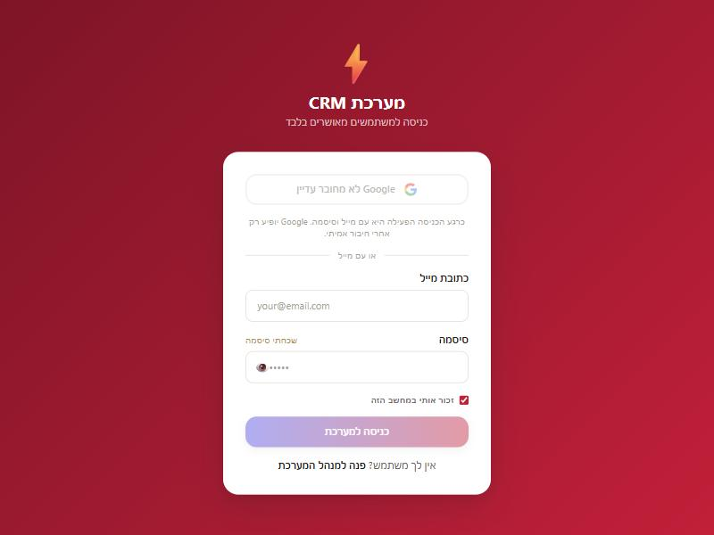 | **מסך כניסה:** אין יותר "שלח בקשת גישה". למטה כתוב "אין לך משתמש? פנה למנהל המערכת" |
| 2 | 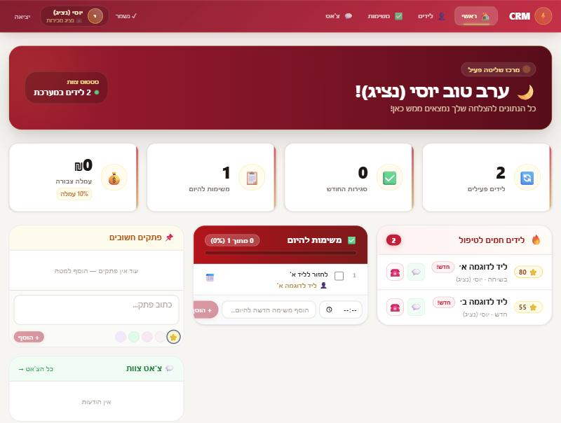 | **נציג (יוסי):** רואה רק את 2 הלידים שלו ואת העמלה שלו. *(הצילום מלפני העדכון של 22.10 — עכשיו יש לו גם לשונית מוצרים, ראו 9–12)* |
| 3 | 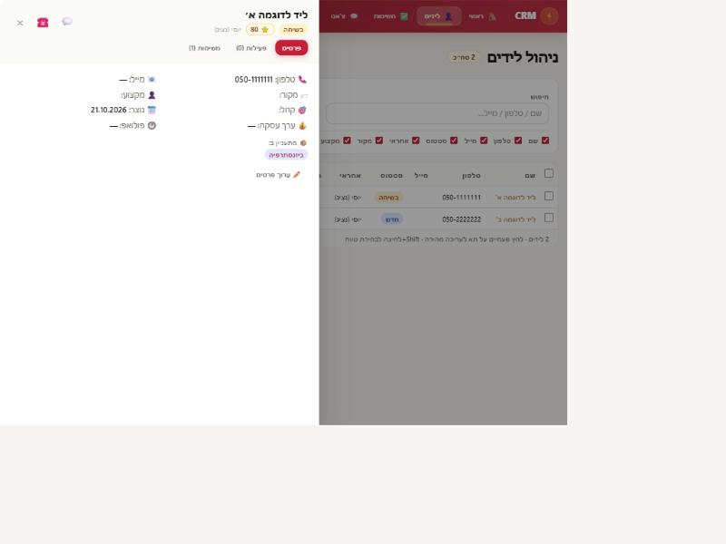 | **נציג, כרטיס ליד:** אין כפתור "מחק" |
| 4 | 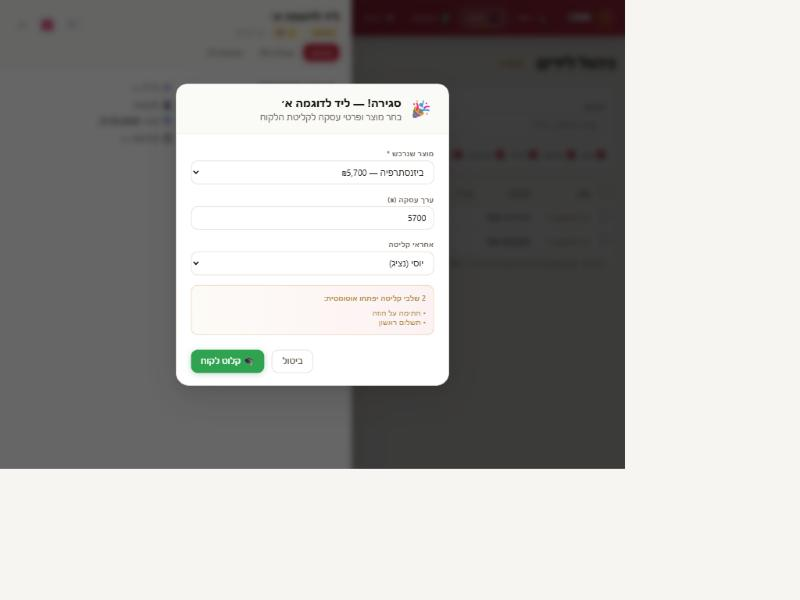 | **נציג סוגר עסקה:** ממלא מוצר, סכום ואחראי. אחרי "קלוט לקוח" הוא **נשאר בלידים**, והלקוח מופיע אצל המזכירות בקליטה |
| 5 | 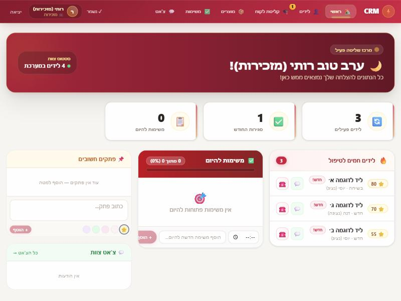 | **מזכירות (רותי):** שש לשוניות, כולל "קליטת לקוח" עם מונה של לקוחות חדשים, ומוצרים. רואה את **כל** 4 הלידים, בלי עמלות |
| 6 | 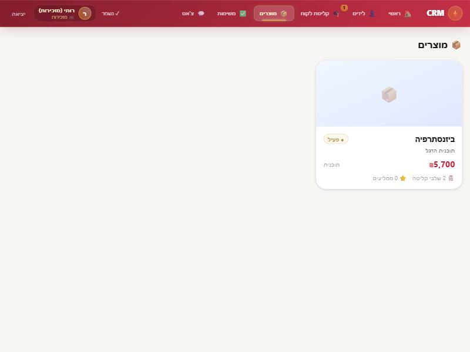 | **מזכירות, מוצרים:** צפייה בלבד, בלי כפתור "מוצר חדש". לחיצה על מוצר פותחת את אותו כרטיס מידע כמו אצל הנציג |
| 7 | 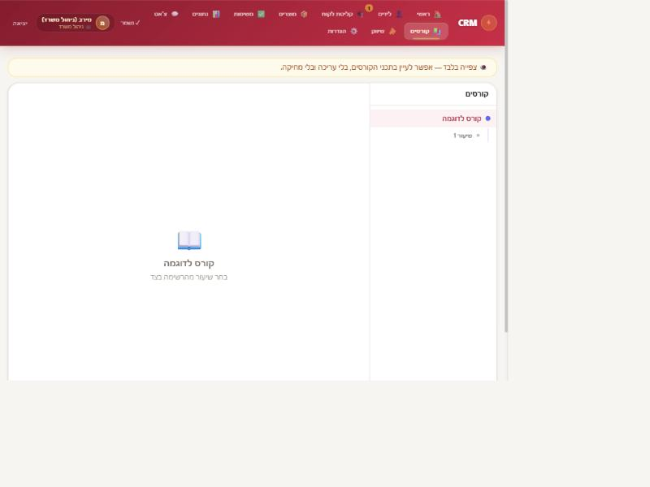 | **ניהול משרד (מירב), קורסים:** פס "צפייה בלבד", בלי כפתורי הוספה, עריכה ומחיקה. בהגדרות אין "משתמשים" ואין "עיצוב" |
| 8 | 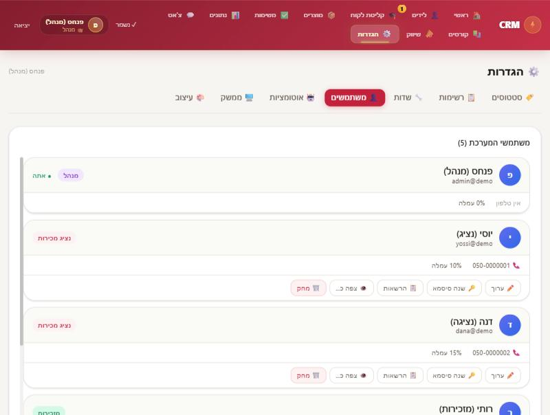 | **מנהל, הגדרות ← משתמשים:** תג תפקיד לכל משתמש, ובחירת תפקיד מתוך ארבעה |
| 9 | 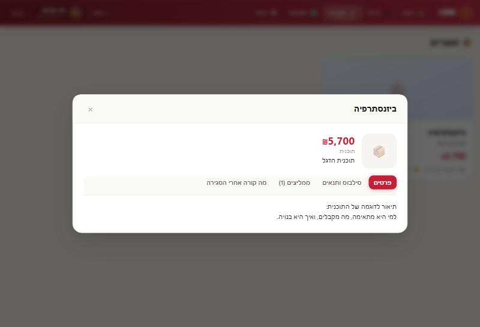 | **נציג, לשונית מוצרים (עדכון 22.10):** כרטיס מידע לצפייה בלבד, בלי כפתור שמירה. לשוניות: פרטים, סילבוס ותנאים, ממליצים, מה קורה אחרי הסגירה |
| 10 | 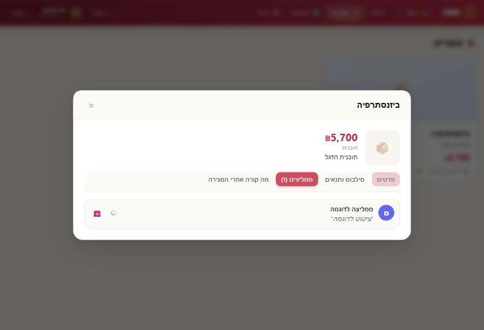 | **נציג, ממליצים:** ציטוט, וכפתורי וואטסאפ וחיוג לממליץ |
| 11 | 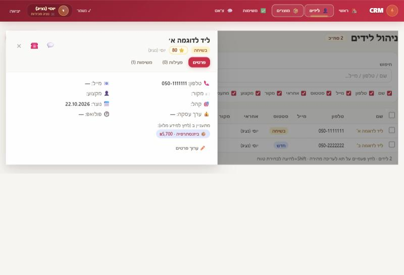 | **נציג, כרטיס ליד:** המוצר שהליד מתעניין בו כולל מחיר, ולחיצה פותחת את כל המידע |
| 12 | 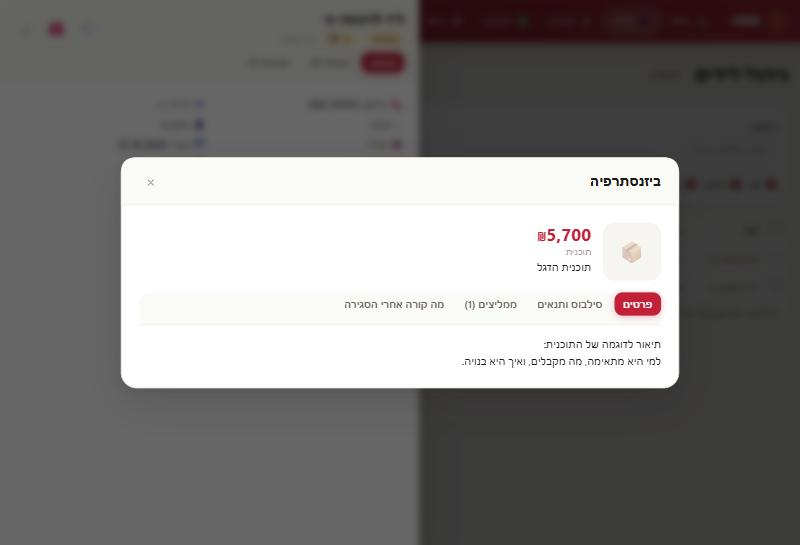 | **נציג, מתוך כרטיס הליד:** כרטיס המוצר נפתח מעל הליד, בלי לעזוב את השיחה |

## מה נבדק אוטומטית (35 בדיקות, כולן עוברות)

הבדיקות מריצות את קוד השרת האמיתי. הן בודקות גם **בקשות שמישהו בנה בעצמו**, לא רק את מה שהמסך מאפשר.
כדי לוודא שהבדיקות באמת תופסות בעיות, שברתי בכוונה שתי הרשאות (מזכירה שמוחקת לידים, ניהול משרד שעורך קורסים). 4 בדיקות נכשלו מיד, כמו שצריך.

**נציג מכירות**
- ✓ רואה רק את הלידים, הפעילויות, המשימות והלקוחות שלו
- ✓ לא יודע שיש קורסים או שיווק: אין נתונים ואין אפילו את שם הלשונית
- ✓ לא רואה עמלות, יעדים, מיילים וטלפונים של נציגים אחרים
- ✓ לא יכול למחוק ליד, גם לא שלו
- ✓ לא יכול לשנות ליד של נציג אחר
- ✓ יכול לעדכן ליד שלו
- ✓ רואה את המוצרים (כדי למכור) אבל לא יכול לשנות אותם
- ✓ לא יכול לשנות או למחוק קורס, גם בבקשה שנבנתה ידנית
- ✓ לא יכול לשנות שיווק או הגדרות

**מזכירות**
- ✓ רואה את כל הלידים, המשימות והלקוחות, ומקבלת מוצרים וקליטה
- ✓ לא רואה קורסים, שיווק, עמלות ויעדים
- ✓ יכולה להעביר ליד מנציג לנציג, וההעברה נרשמת ביומן הליד ("🔀 הליד הועבר מיוסי לדנה (ע"י רותי)")
- ✓ לא יכולה למחוק ליד
- ✓ יכולה ליצור משימה לנציג אחר
- ✓ לא יכולה לשנות מחירי מוצרים

**ניהול משרד**
- ✓ רואה הכל, כולל קורסים, שיווק ועמלות
- ✓ צופה בקורסים בלבד, לא יכול לערוך ולא למחוק
- ✓ יכול לעבוד בשיווק ולשנות סטטוסים
- ✓ לא יכול לשנות משתמשים ותפקידים (אחרת היה הופך את עצמו למנהל)

**מנהל**
- ✓ רואה הכל, אבל אף פעם לא סיסמה, ולא את מונה ה-AI הפנימי
- ✓ סיסמה שנשלחת בטעות בהגדרות לא נשמרת
- ✓ יכול לערוך ולמחוק קורסים
- ✓ אי אפשר לדרוס או למחוק את מונה ה-AI דרך שמירה רגילה
- ✓ כל סוג נתונים שהמסך שומר באמת נשמר בשרת
- ✓ שמירה לא מוחקת רשומות שלא נשלחו (הבאג של איבוד הלידים)

**כללי**
- ✓ תפקיד לא מוכר (גם טעות הקלדה כמו "Secretary") לא מקבל נתונים ולא יכול לשמור
- ✓ "לשוניות מותרות" רק מצמצמות בתוך התפקיד. אי אפשר לתת לנציג קורסים
- ✓ נציג ומזכירות לא יכולים להפעיל את מחולל המסרים
- ✓ ניהול משרד יכול להפעיל אותו
- ✓ אחרי 30 הפעלות ביום הוא נעצר עם הודעה בעברית
- ✓ רק מנהל מקבל כתובת להעלאת קבצי קורסים
- ✓ אי אפשר לבקש העלאה לתיקייה שהאפליקציה לא משתמשת בה

## מה ההדגמה לא בדקה

- **המסד האמיתי.** המיגרציה (הגנת טבלאות, נעילת קבצים, תפקידים) תיבדק רק כשפנחס יריץ אותה ואת שאילתות הבדיקה (ראו `03-הוראות-שלב-1.md`).
- **העלאת קובץ אמיתית ל-Supabase** עם הכתובת החתומה. נבדק רק שהשרת נותן כתובת למנהל ומסרב לאחרים.
- **כניסה אמיתית** עם מייל וסיסמה. בהדגמה הכניסה מדומה.
